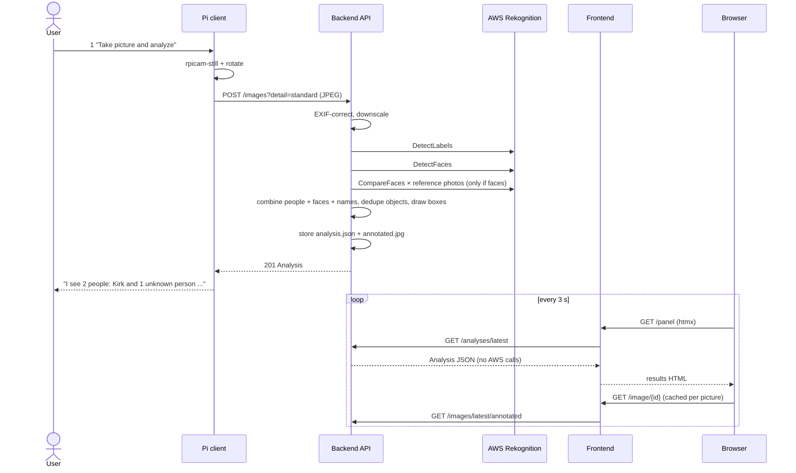

# B.R.U.T.U.S.

## Introduction
Brutus is an artificial intelligence robot built on top of AWS machine learning services, Raspberry Pi and related machinery. The project is coded in Python 3.15.

[](https://www.youtube.com/watch?v=4MI_6AYFU6Y)

The project has three services:
- a Raspberry Pi terminal client;
- a backend API built with [FastAPI](https://fastapi.tiangolo.com);
- a frontend rendered with [Jinja2](https://jinja.palletsprojects.com) and refreshed with [htmx](https://htmx.org).

The backend and frontend are served by [uvicorn](https://www.uvicorn.org), and you can open the frontend in a browser on your local network.

[uv](https://docs.astral.sh/uv/) manages Python and the dependencies. [Ruff](https://docs.astral.sh/ruff/) lints and formats the code, and [mypy](https://mypy-lang.org) type-checks it in strict mode. The [pre-commit framework](https://pre-commit.com) runs the checks before each commit.


## Features
### Now
- **Image recognition:** take a picture, then:
  - [recognise objects and animals](https://docs.aws.amazon.com/rekognition/latest/dg/labels-detect-labels-image.html);
  - [count and box people and faces](https://docs.aws.amazon.com/rekognition/latest/dg/faces.html);
  - [recognise known people](https://docs.aws.amazon.com/rekognition/latest/dg/faces-comparefaces.html) from reference photos.

  Everyone in the picture is counted and boxed once, whether or not their face is visible. There are three levels of detail:
  - `basic`: counts and boxes;
  - `standard` (default): adds names of known people and boxes for objects;
  - `detailed`: adds face attributes such as age range, emotion and glasses.

  

- **Speech generation:** [Brutus can speak](https://docs.aws.amazon.com/polly/latest/dg/synthesize-example.html) whatever (English) text is given to it.

### Upcoming
- **Weather detection:** get room temperature, humidity and air pressure from a [RuuviTag](https://github.com/ttu/ruuvitag-sensor).
- **Servo motors:** give Brutus arm movement with servo motors through an Arduino.
- **Voice commands:** call Brutus' features through Amazon Alexa.
- **Discussion mode:** use Amazon Lex and AWS Bedrock to return poems or summaries of image analysis results, or to discuss philosophy with Brutus.

## Architecture
### High-level architecture
#### Vision
*Have a robot that can take pictures, analyze them and present results to the audience. The robot should be able to speak and listen to commands. Software should be modular and easy to extend with new features.*


#### Implementation
- **Raspberry Pi client:** a terminal menu that takes pictures, uploads them and plays audio. After each picture it prints what Brutus sees, for example *"I see 2 people: Kirk and 1 unknown person, 1 dog, 2 chairs."*
- **Backend:** analyzes each uploaded picture **once** and stores the result (`analysis.json`) and the annotated image. Reading results never calls AWS. Its code is a functional core with an imperative shell:
  - `brutus/vision/` holds immutable models and pure functions for geometry, parsing Rekognition responses, combining people and faces, removing duplicate objects and drawing;
  - `pipeline.py`, `store.py` and `api.py` are the only places that talk to AWS, the filesystem or HTTP.
- **Frontend:** a server-rendered page. htmx refreshes the results panel every 3 seconds. The browser only talks to the frontend, which also serves the annotated image from the backend.

### API event flow


### Backend API
| Method | Path | Purpose |
|---|---|---|
| GET | `/health` | Health check |
| POST | `/images?detail=basic\|standard\|detailed` | Upload a JPEG; analyze it and store the result |
| POST | `/analyses?detail=…` | Re-analyze the latest picture |
| GET | `/analyses/latest` | Latest analysis (sends an `ETag`; `If-None-Match` returns 304) |
| GET | `/images/latest/annotated` | Latest annotated JPEG |
| POST | `/speech?text=…` | MP3 speech from Polly |

The OpenAPI docs are at `http://<host>:8000/docs`.

## Project Structure
```
brutus/
├── backend/
│   ├── src/brutus/
│   │   ├── vision/        # models, geometry, parse, objects, people, imaging, annotate, pipeline
│   │   ├── api.py         # FastAPI app factory
│   │   ├── store.py       # latest picture, analysis and reference faces on disk
│   │   ├── speech.py      # Polly
│   │   ├── settings.py    # configuration (.env)
│   │   └── cli.py         # brutus-analyze: analyze an image file without a Pi
│   └── tests/
├── frontend/
│   ├── src/brutus_frontend/  # app.py, view.py, templates/, static/
│   └── tests/
├── raspberrypi_client/
│   ├── brutus_pi.py       # terminal client
│   ├── audio/
│   └── tests/
└── scripts/               # start_fe_be.sh, start_client.sh, stop.sh
```
Each service is its own uv project, with its own `pyproject.toml`, `uv.lock` and `.env`.

## Installation

### Hardware prerequisites
- Raspberry Pi (confirmed working on a model 3B) running **64-bit Raspberry Pi OS**. Python 3.15 packages for Pillow and pygame-ce are published for arm64 only. Check with `uname -m`, which should print `aarch64`.
- Raspberry Pi Camera (v2 or newer)
- Speaker
- Mannequin (mandatory, code won't work without this.)

### Software prerequisites
- [uv](https://docs.astral.sh/uv/getting-started/installation/). It installs Python 3.15 for you.
- AWS CLI configured with AWS SSO
- An IAM role with the right permissions ([see the example IAM role definition](./brutus-iam-role.yaml))
- On the Pi: `sudo apt-get install awscli rpicam-apps`, then enable the camera with `sudo raspi-config`

### Setup
1. Clone the repository and install uv and Python:
   ```bash
   git clone https://github.com/avecci/brutus.git && cd brutus
   curl -LsSf https://astral.sh/uv/install.sh | sh
   uv python install 3.15
   ```
2. Configure AWS:
   ```bash
   aws configure sso
   ```
3. Copy `.env.template` to `.env` in `backend/`, `frontend/` and `raspberrypi_client/`, and fill it in:
   - `backend/.env`: `AWS_PROFILE`, `AWS_REGION`
   - `frontend/.env`: `BACKEND_URL` (`http://localhost:8000` when everything runs on the Pi)
   - `raspberrypi_client/.env`: `BACKEND_URL`, plus optional `CAMERA_ROTATION` and `DETAIL`
4. Add reference photos of the people Brutus should know to `backend/reference_library/`, named `<Name>.jpg`.
5. Install the dependencies in each service:
   ```bash
   (cd backend && uv sync) && (cd frontend && uv sync) && (cd raspberrypi_client && uv sync)
   ```

### Running
Start the backend and frontend together, then the client:
```bash
scripts/start_fe_be.sh     # backend :8000, then frontend :3000 once healthy
scripts/start_client.sh    # terminal menu (needs the camera and speaker)
scripts/stop.sh
```
Then open `http://<pi-ip>:3000` in a browser on the same network.

### Local development
Run each service in its own terminal:
```bash
cd backend && uv run task dev              # needs AWS access
cd frontend && uv run task dev
cd raspberrypi_client && uv run task start # needs the Pi camera and speaker
```
You can analyze an image file without a Pi:
```bash
cd backend && uv run brutus-analyze path/to/photo.jpg --detail detailed --out annotated.jpg
```

## Troubleshooting
1. **Camera not working**
   - Check that the camera is enabled: `sudo raspi-config`
   - Take a test picture: `rpicam-still -o test.jpg`
2. **AWS authentication**
   - Log in again: `aws sso login`
   - Check the role permissions
3. **Audio issues**
   - Test the audio: `speaker-test -t wav`
   - Check the volume: `alsamixer`
4. **`uv sync` builds packages from source on the Pi**
   - You are on 32-bit Raspberry Pi OS. Reflash it with the 64-bit image.

## Monitoring
- The backend writes JSON logs to `backend/logs/brutus.log`, rotated daily and kept for 14 days. Each entry includes the analysis id and the counts.
- The Pi client logs to `raspberrypi_client/logs/brutus_pi.log`.

## Tests
Run these in each service:
```bash
uv run task test     # unit tests; AWS is stubbed with botocore Stubber
uv run task lint     # ruff
uv run task check    # mypy --strict
```
The backend also has tests against real AWS Rekognition. They need `aws sso login` and cost a little per run:
```bash
cd backend && uv run task test-integration
```
To run every check before committing:
```bash
pre-commit run --all-files
```
